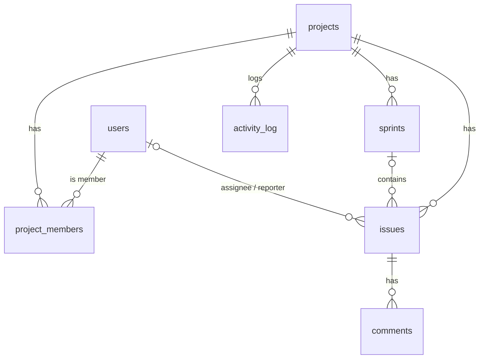

# Issue Tracker: Learning Guide

This guide explains **how the project works and why it's built this way**, in the order you should learn it.
Read it next to the code: every file mentioned here exists in the repo.

---

## 1. The big picture (restaurant analogy)

| Restaurant | Issue Tracker |
|---|---|
| Customer + menu | **Browser** running the React app (`frontend/`) |
| Waiter taking orders | **HTTP requests** (JSON over REST) |
| Security guard checking ID at the kitchen door | **JwtAuthFilter**: checks the token on every request |
| Head waiter routing orders | **Controllers** (`*Controller.java`) |
| Chefs who know the recipes and rules | **Services** (`*Service.java`): all business logic |
| Store room clerk | **Repositories** (`*Repository.java`): read/write the database |
| Store room | **PostgreSQL** |
| Kitchen bell "order ready!" | **SSE live events** pushed to every open board |

The golden rule: **Controller → Service → Repository**. Controllers never touch the DB directly; repositories never contain business rules.

---

## 2. Java you need first (checklist)

Spring Boot *is* Java, so make sure you can explain each of these:

- Classes, objects, constructors, `private` fields with getters
- Interfaces (every repository here is just an interface)
- `enum` with methods → see `ProjectRole.atLeast()`
- `record` (Java 16+): immutable data classes → all the DTOs, e.g. `IssueDtos.CreateIssueRequest`
- Collections: `List`, `Map`, `Set`, and `Optional` (`findById(...).orElseThrow(...)`)
- Streams + lambdas: `list.stream().map(X::from).toList()`
- Exceptions: `ApiException extends RuntimeException`
- Generics: `PageResponse<T>`
- Annotations (`@Something`): metadata that Spring reads at startup

---

## 3. Spring Boot core ideas

### 3.1 Beans and dependency injection (DI)
When the app starts, Spring scans `com.issuetracker`, finds classes marked `@Service`, `@RestController`, `@Component`, `@Configuration`, and creates **one object of each** (a *bean*).

If a constructor needs other beans, Spring passes them in automatically:

```java
public IssueService(IssueRepository issues, ProjectAccess access, ...) { ... }
```

You never write `new IssueService(...)`. **Why it matters:** in tests you can swap real parts for fakes, and classes stay loosely coupled.

### 3.2 Annotation cheat sheet (all used in this project)

| Annotation | Meaning |
|---|---|
| `@SpringBootApplication` | Start here; enable auto-configuration and scanning |
| `@RestController` / `@RequestMapping` | This class answers HTTP requests under a path |
| `@GetMapping`, `@PostMapping`, … | Which HTTP method + path runs this method |
| `@PathVariable`, `@RequestParam`, `@RequestBody` | Read from URL path, `?query=`, or JSON body |
| `@Valid` + `@NotBlank`, `@Size`, `@Email` | Validate input automatically → 400 with field errors |
| `@Service`, `@Component`, `@Repository` | Make this class a bean |
| `@Transactional` | Everything in this method commits together or rolls back together |
| `@Entity`, `@Table`, `@Column`, `@Id` | Map a class to a DB table (JPA/Hibernate) |
| `@ManyToOne(fetch = LAZY)` | Foreign key to another entity, loaded only when used |
| `@Version` | Optimistic locking counter |
| `@Query`, `@Modifying`, `@Lock`, `@EntityGraph` | Custom queries, bulk updates, row locks, eager joins |
| `@AuthenticationPrincipal` | Inject the logged-in user into a controller method |
| `@TransactionalEventListener` | Run after the DB transaction commits |
| `@Scheduled` | Run every N ms (SSE heartbeat) |

### 3.3 Configuration
`backend/src/main/resources/application.yml`: every `${NAME:default}` reads an **environment variable**, so the same JAR runs on your laptop (defaults) and on Render (real secrets set in the dashboard). Secrets are never committed to git.

---

## 4. Follow one request end to end: "drag MOB-4 to Done"

1. **React** (`BoardPage.tsx → onDragEnd`) works out the neighbour cards, moves the card on screen immediately (*optimistic UI*), and calls
   `api.moveIssue(...)` → `POST /api/projects/1/issues/4/move` with body `{"status":"DONE","afterIssueId":2,"beforeIssueId":null}` and header `Authorization: Bearer <jwt>`.
2. **CORS**: the browser checks the API allows the Vercel origin (`SecurityConfig.corsConfigurationSource`).
3. **JwtAuthFilter** verifies the token signature and expiry → puts `AuthUser(id=1)` into Spring Security's context.
4. **SecurityConfig**: the path isn't public, and the user is authenticated → allowed through.
5. **IssueController.move** maps JSON → `MoveIssueRequest` record, validates `@NotNull status`, and calls the service.
6. **IssueService.move** (inside a `@Transactional`):
   - `access.require(projectId, userId, MEMBER)` → 404 if not a member, 403 if only a viewer
   - loads issue 4 and its neighbours, computes the new **fractional position**
   - sets status + position; `issues.flush()` sends `UPDATE issues SET … WHERE id=4 AND version=3`
   - records an `activity_log` row and publishes a `ProjectEvent`
7. **Commit** → **EventBroadcaster** (`AFTER_COMMIT`) pushes `event: change` down every open SSE connection for project 1.
8. **Other browsers** (`ProjectLayout.tsx` EventSource) receive it → `liveTick++` → the board refetches → toast "Priya moved MOB-4 to Done".
9. If the request had failed, step 1's optimistic change is **rolled back** and an error toast is shown.

Trace this path in the code once with a debugger and you'll understand 80 % of the project.

---

## 5. The database



Key ideas (all in `V1__init_schema.sql`):
- **Flyway migrations**: SQL files run once, in order, tracked in `flyway_schema_history`. To change the schema, add `V2__...sql`; never edit V1 once it has run.
- **Constraints do real work**: `UNIQUE (project_id, number)`, `CHECK (status IN …)`, `ON DELETE CASCADE`, and the partial unique index `ux_one_active_sprint`.
- **Indexes match the queries**: `(project_id, status, position)` serves the board, and the GIN index serves search.
- **JPA mapping**: `Issue.java` ↔ `issues` table. Hibernate writes the SQL. Turn on `logging.level.org.hibernate.SQL: DEBUG` to see it.
- **Lazy loading & N+1**: listing 50 issues and then touching `issue.getAssignee()` 50 times = 51 queries. `@EntityGraph(attributePaths = {"assignee", …})` makes it 1 query.

---

## 6. Security, simply

- **BCrypt**: passwords are stored as slow, salted hashes. Even you can't read them.
- **JWT**: on login the server signs `{sub: userId, exp: …}` with a secret key. The browser sends it on every request; the server verifies the signature (no DB lookup, no session) → **stateless**, easy to scale.
- **Authorization**: being logged in ≠ allowed. `ProjectAccess.require(...)` checks membership + role for every project action.
- **CORS**: browsers block JS on site A from calling API B unless B says "A is allowed".
- **Trade-off you should mention**: JWTs can't be revoked before expiry. Production systems add short-lived access tokens + refresh tokens.

---

## 7. Frontend tour

| File | Job |
|---|---|
| `src/api.ts` | Typed client: one function per endpoint, error handling, "server waking up" detection |
| `src/auth.tsx` | React Context holding the logged-in user; token in `localStorage` |
| `src/App.tsx` | Routes + `RequireAuth` guard |
| `pages/ProjectLayout.tsx` | Sidebar, global search (debounced), SSE connection, toasts, issue modal via `?issue=ID` |
| `pages/BoardPage.tsx` | Kanban + dnd-kit drag-and-drop + optimistic update/rollback |
| `pages/BacklogPage.tsx` | Sprints lifecycle + move issues between sprints |
| `components/IssueModal.tsx` | Create/edit form, 409-conflict handling, comments, history |

---

## 8. Testing

`IssueTrackerApiIntegrationTest` boots the **whole app** against a **real PostgreSQL** in Docker (Testcontainers) and calls the API through MockMvc:
lifecycle (create → move → search → comment), 409 on stale edits, permissions (outsider 404, viewer 403, no token 401), sprint rules, and validation messages.
Run: `mvn verify` (Docker must be running). CI runs it on every push.

---

## 9. Suggested learning path (2–3 weeks, ~2 h/day)

| Days | Do this |
|---|---|
| 1–2 | Run it with `docker compose up --build`. Click everything. Open Swagger and call endpoints by hand. |
| 3–4 | Read `user/` + `security/`. Register via Swagger, decode your token at jwt.io. |
| 5–7 | Read `project/` + `issue/`. Put a breakpoint in `IssueService.move` and drag a card. |
| 8–9 | Read the SQL migration. Connect with a DB tool (DBeaver/pgAdmin) and watch rows change. |
| 10 | Read the test file; break a rule in the code and watch a test fail. |
| 11–14 | **Build a feature yourself** (below). |
| 15+ | Deploy (DEPLOYMENT.md), then add it to your resume. |

### Exercises (in increasing difficulty)
1. **Due dates**: add `due_date DATE` in `V2__add_due_date.sql`, a field in `Issue`, the DTOs and the modal; show overdue cards in red.
2. **Labels**: new `labels` + `issue_labels` tables (many-to-many), filter the board by label.
3. **Rate-limit login**: max 5 attempts/minute per IP (a `ConcurrentHashMap` or the Bucket4j library).
4. **Burndown chart** for the active sprint (points remaining per day, computed from `activity_log`).
5. **AI auto-triage**: on create, call an LLM API to suggest type/priority from the description. This ties straight into your AI profile.

---

## 10. Interview questions you can now answer

1. **How do you stop two users getting the same issue number?** A pessimistic row lock (`SELECT … FOR UPDATE`) on the project while incrementing its counter, plus a unique constraint as the safety net.
2. **Optimistic vs pessimistic locking?** Pessimistic locks rows up front (short critical sections like numbering). Optimistic checks a version at save time (long "think time" edits like a form). I use both, each where it fits.
3. **How does drag-and-drop ordering scale?** Fractional positions: one UPDATE per move, with occasional rebalancing.
4. **Why SSE and not WebSockets?** Updates only flow server → client; SSE is plain HTTP, auto-reconnects, and passes proxies easily.
5. **What breaks with two API instances?** In-memory SSE subscribers. Fix: publish events through Redis Pub/Sub or Postgres LISTEN/NOTIFY so every instance relays them.
6. **What is the N+1 problem and how did you avoid it?** See section 5.
7. **Why return 404 instead of 403 for non-members?** To avoid leaking which project ids exist.
8. **Why publish events after commit?** So clients never see changes that roll back.
9. **How are schema changes deployed safely?** Versioned Flyway migrations run on startup, in CI tests too.
10. **How would you add search to millions of issues?** Postgres FTS + GIN scales far, then move to OpenSearch/Elasticsearch fed by change-data-capture if needed.

---

## 11. Resume bullets (edit to taste)

- Built **Issue Tracker**, a JIRA-style issue tracker (Java 21, Spring Boot 3, PostgreSQL, React + TypeScript) with Kanban boards, sprints, role-based access control and real-time updates via Server-Sent Events; deployed on Render/Neon/Vercel with Docker and GitHub Actions CI.
- Ensured data integrity under concurrency using **pessimistic row locks** for issue numbering, **optimistic locking** (`@Version`) to prevent lost updates, and DB-enforced invariants (partial unique index for a single active sprint).
- Implemented O(1)-write drag-and-drop ordering with **fractional indexing**, and ranked **full-text search** with PostgreSQL `tsvector` + GIN indexes.
- Wrote integration tests with **Testcontainers** against real PostgreSQL covering auth, permissions, concurrency conflicts and sprint workflows.
